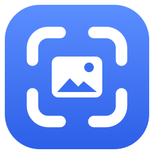
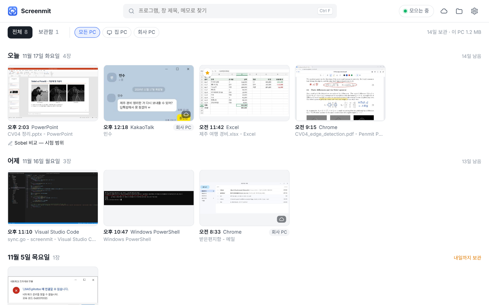
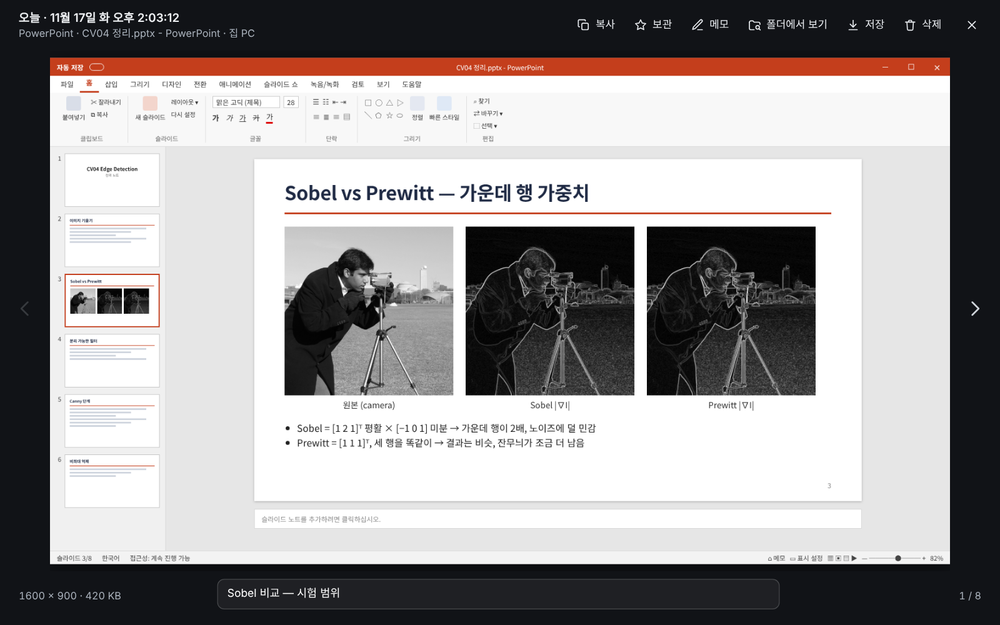
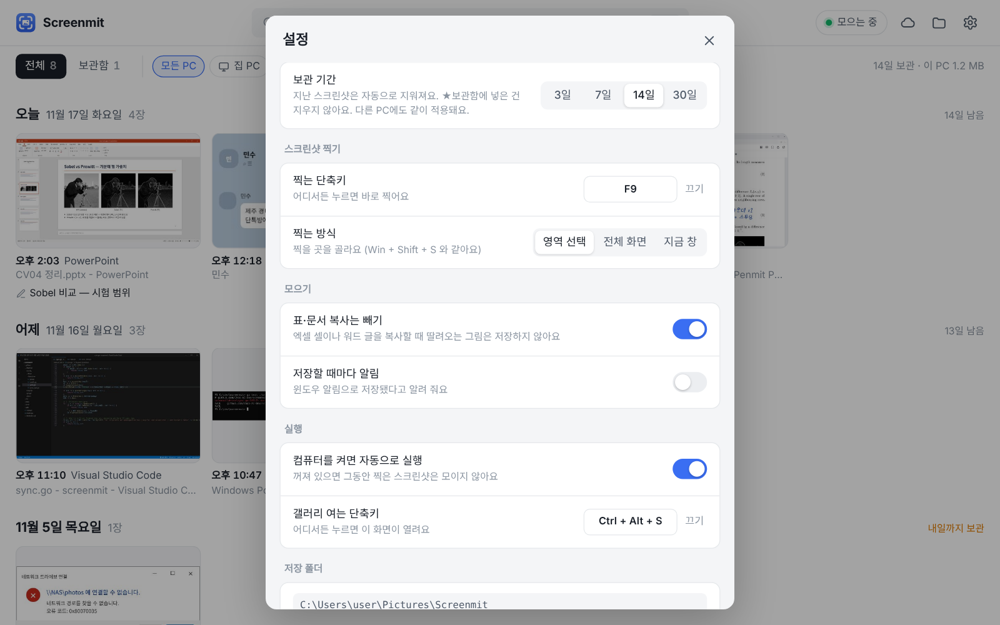
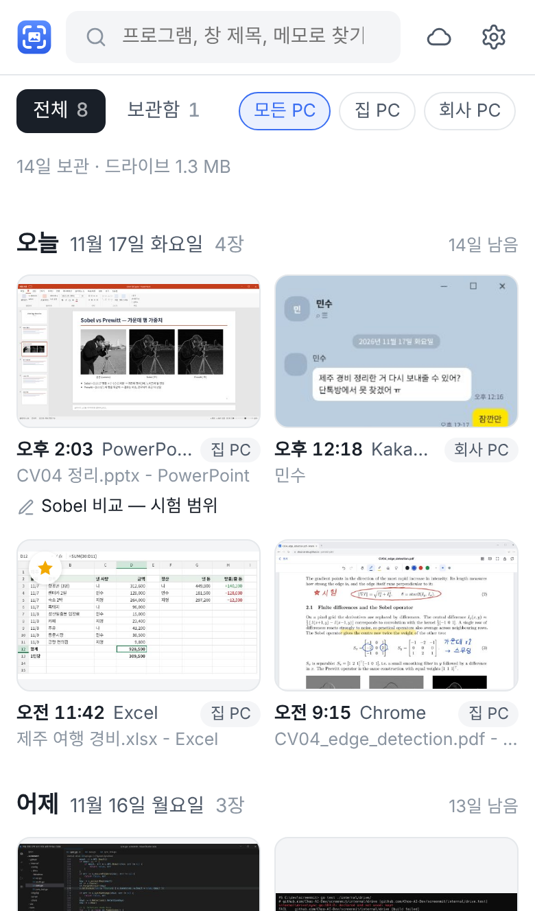
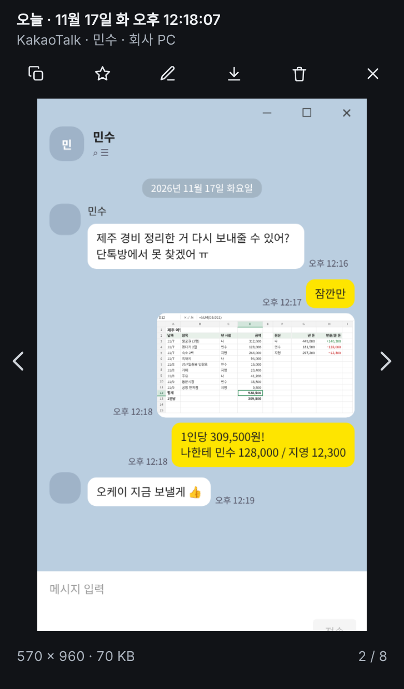

<p align="center"></p>

<h1 align="center">Screenmit (스크린밋)</h1>

<p align="center">찍어 둔 스크린샷, 나중에 찾으면 없죠?<br>
Screenmit 은 캡처할 때마다 알아서 모아 두고, 기간이 지나면 알아서 지워요.<br>
회사 PC에서 찍은 걸 집 PC와 휴대폰에서도 봐요.</p>

<p align="center"><b>Windows 10 · 11</b> · 설치 없음 · 무료 · 서버 없음<br>
<a href="../../releases"><b>다운로드</b></a> · <a href="https://choo-ai-dev.github.io/Screenmit/">웹에서 보기</a> · <a href="#english">English</a></p>



## 왜 만들었나

PC에서 스크린샷을 자주 찍어 써요. 표 하나, 오류 창 하나, 슬라이드 한 장. 그런데 며칠 지나 다시 찾으면 없어요. 클립보드는 다음 복사에 덮이고, 붙여 넣은 대화방은 흘러가 버리고, 집에서 찍은 건 회사에 없고요.

그래서 찍는 순간 알아서 저장해 두고, 1~2주 지나면 알아서 비우는 앱을 만들었어요. 평소처럼 캡처만 하면 돼요.

## 이렇게 동작해요

- **평소처럼 캡처만 하면 돼요.** `Win + Shift + S`, `Print Screen`, `Alt + Print Screen`, 알캡처·픽픽처럼 클립보드로 복사하는 캡처는 다 모여요.
- **어디서 찍었는지 같이 기록해요.** PowerPoint, Excel, 카카오톡, 창 제목까지. 갤러리에서 `경비`, `kakao`, `sync.go` 처럼 찾으면 돼요.
- **기간이 지나면 지워요.** 기본 14일 (3·7·14·30일 중 선택). 남길 건 ★를 누르면 `보관함` 폴더로 옮겨지고 지워지지 않아요.
- **회사 PC ↔ 집 PC ↔ 휴대폰.** 구글 드라이브를 연결하면 각 PC가 찍은 걸 내 드라이브 `Screenmit` 폴더에 올리고, 다른 PC와 웹에서 같이 보여요. ★·메모·삭제도 서로 반영돼요.
- **파일 그대로.** `사진\Screenmit\2026-11-17\Screenmit_2026-11-17_14-03-12.png` 처럼 날짜별 폴더에 PNG 로 저장돼요. 탐색기에서 바로 열 수 있어요.

| 크게 보기 | 설정 |
|---|---|
|  |  |

## 쓰는 법

1. [Releases](../../releases) 에서 `Screenmit.exe` 를 받아 아무 폴더에 두고 실행해요. 처음 실행할 때 "Windows의 PC 보호" 창이 뜨면 **추가 정보 → 실행** (코드 서명이 없어서 그래요).
2. 작업 표시줄 오른쪽(트레이)에 아이콘이 생겨요. 이제 캡처하면 모여요.
3. 트레이 아이콘을 누르거나 `Ctrl + Alt + S` 를 누르면 갤러리가 열려요.

| 하기 | 방법 |
|---|---|
| 다시 복사 | 카드의 복사 버튼, 또는 보기 화면에서 `Ctrl + C` |
| 보관 (안 지워지게) | ★, 또는 `P` |
| 메모 | 보기 화면에서 `M` → 쓰고 `Enter`. 검색돼요 |
| 삭제 | `Delete` (5초 안에 되돌리기) |
| 찾기 | `Ctrl + F` |
| 다른 앱으로 | 썸네일을 끌어다 놓기 |

- **다른 키로 찍기:** 설정 → **스크린샷 찍기** 에서 단축키를 정하면 Print Screen 대신 그 키로 찍어요 (예: `F9`, `Ctrl + Shift + A`, `Pause`). 찍는 방식은 **영역 선택**(Win + Shift + S 와 같은 Windows 캡처 도구), **전체 화면**, **지금 창** 중에서 골라요. 전체 화면과 지금 창은 누르는 순간 저장하고 클립보드에도 복사해 둬요.
- 비밀번호처럼 남기기 싫은 걸 캡처할 땐 위쪽 **모으는 중** 을 눌러 잠깐 멈춰요. 비밀번호 관리자가 "기록하지 말라"고 표시한 복사는 처음부터 저장하지 않아요.
- 엑셀 셀이나 워드 글을 복사할 때 딸려오는 그림은 저장하지 않아요 (설정에서 끌 수 있어요).
- 업데이트: 트레이 아이콘 → 끝내기 후 새 exe 로 바꿔 실행하면 돼요. 모은 스크린샷과 설정은 그대로예요.

## 다른 PC·휴대폰에서 보기

### PC 끼리 (구글 드라이브)

Screenmit 설정의 **다른 PC와 같이 보기** 에서 연결해요. 처음 한 번은 구글 클라이언트 JSON 이 필요해요 ([아래](#구글-앱-만들기)).

1. 받은 `client_secret_….json` 을 설정 화면에 끌어다 놓기
2. 이 PC 이름 고르기 (회사 PC / 집 PC)
3. **연결** → 구글 계정으로 로그인

다른 PC에서도 Screenmit 을 실행하고 같은 JSON, 같은 구글 계정으로 연결하면 서로의 스크린샷이 보여요. 목록은 작은 썸네일만 받고, 원본은 열 때 받아요.

### 휴대폰·앱 없는 PC (웹)

**https://choo-ai-dev.github.io/Screenmit/** — PC 앱과 같은 화면이에요. 구글 계정으로 로그인하면 내 드라이브의 `Screenmit` 폴더를 브라우저가 바로 읽어요 (서버 없음).

<p> </p>

- 찾기, PC별 보기, 크게 보기(옆으로 밀어서 넘기기), 복사, 저장(휴대폰은 공유 시트), ★보관, 메모, 삭제, 보관 기간. 바꾼 건 PC 앱에도 그대로 반영돼요.
- 휴대폰에서 **홈 화면에 추가**하면 앱처럼 열려요.
- 로그인은 한 시간 유지되고, 지나면 버튼 한 번으로 다시 들어가요.

### 구글이 안 될 때

- **PC 앱:** 로그인이 풀리거나 회사망에서 구글이 막히면, 다른 PC 사진과 경고를 숨기고 이 PC 스크린샷만 조용히 보여 줘요. 상태와 "다시 연결"은 설정에 있어요.
- **웹:** PC 앱 설정 → 정보 → **웹에서 열기**로 한 번 열면, 그 브라우저에서는 구글 로그인이 없거나 안 될 때 이 PC의 스크린샷을 대신 보여 줘요. 브라우저가 "이 기기 접근"을 물으면 허용해 주세요.

> 회사 화면을 개인 드라이브에 올리는 거라, 회사 보안 규정은 한번 확인해 주세요. 연결하지 않으면 스크린샷은 이 PC 밖으로 나가지 않아요.

## 구글 앱 만들기

PC 앱이 쓸 구글 클라이언트예요. 처음 한 번, 5분, 무료예요.

1. [console.cloud.google.com](https://console.cloud.google.com) → 새 프로젝트 `Screenmit`
2. API 및 서비스 → 라이브러리 → **Google Drive API** 사용
3. Google 인증 플랫폼 → 시작하기: 앱 이름 `Screenmit`, 대상 **외부**
4. 데이터 액세스 → 범위 추가 → `https://www.googleapis.com/auth/drive.file`
5. 대상 → **앱 게시** (테스트 상태로 두면 7일마다 로그인이 풀려요)
6. 클라이언트 → 클라이언트 만들기 → 유형 **데스크톱 앱** → **JSON 다운로드**

- JSON 에는 비밀 값이 들어 있어요. 채팅이나 저장소에 올리지 말고 PC 에만 두세요.
- 권한은 `drive.file` 하나라서, Screenmit 이 만든 파일만 볼 수 있어요. 드라이브의 다른 파일은 못 봐요.
- 로그인 정보는 Windows 계정 키로 암호화해서 `%APPDATA%\Screenmit` 에 둬요. [개인정보처리방침](https://choo-ai-dev.github.io/Screenmit/privacy.html)
- 웹 페이지(choo-ai-dev.github.io)는 이 저장소의 구글 앱으로 로그인해요. 드라이브 권한이 구글 앱(프로젝트) 단위라서, **직접 만든 구글 앱으로 연결했다면** 저장소를 포크하고 같은 프로젝트에 **웹 애플리케이션** 클라이언트(승인된 JavaScript 원본 `https://<아이디>.github.io`, 리디렉션 URI `https://<아이디>.github.io/Screenmit/`)를 만들어 저장소 변수 `GOOGLE_WEB_CLIENT_ID` 로 넣고 내 Pages 로 배포하세요.
- 브랜딩: 로고는 올리지 않기(올리면 심사), 홈페이지 `https://choo-ai-dev.github.io/Screenmit/`, 개인정보처리방침 `https://choo-ai-dev.github.io/Screenmit/privacy.html`, 승인된 도메인 `choo-ai-dev.github.io`.

## 저장 위치

| 무엇 | 어디 |
|---|---|
| 스크린샷 | `사진\Screenmit\<날짜>\` (설정에서 바꿀 수 있어요) |
| 보관함 | `사진\Screenmit\보관함\` |
| 목록·썸네일 | `사진\Screenmit\.screenmit\` (숨김) |
| 설정·로그 | `%APPDATA%\Screenmit\` |
| 드라이브 | 내 드라이브 `Screenmit\` |

자동 실행은 `HKCU\…\Run` 에 등록돼요. 지우려면 설정에서 끄고 exe 를 지우면 끝이에요.

## 만들기

Go 1.24 만 있으면 돼요 (외부 라이브러리 없음).

```sh
GOOS=windows GOARCH=amd64 go build -trimpath -ldflags "-H windowsgui -s -w" -o Screenmit.exe .
```

- 아이콘·버전 정보: `node tools/render_icons.mjs /tmp/icons && python3 tools/mkres.py /tmp/icons 0.1.0`
- 웹 페이지: `python3 tools/build_site.py _site` (갤러리 `web/static` + 드라이브 연결 `site/drive.js`). main 에 올리면 `.github/workflows/pages.yml` 이 GitHub Pages 로 배포해요 (처음 한 번 Settings → Pages → Source 를 **GitHub Actions** 로).
- 릴리스: `VERSION` 의 숫자를 올려 main 에 올리면 `.github/workflows/release.yml` 이 exe 를 만들고 그 번호로 태그와 릴리스를 만들어요. 설명은 `RELEASE_NOTES.md`. 저장소 시크릿 `GOOGLE_DESKTOP_CLIENT_ID`, `GOOGLE_DESKTOP_CLIENT_SECRET` 을 넣으면 exe 에 구글 앱이 들어가서 JSON 없이 바로 연결돼요.
- README 사진: `node tools/docs_shots.mjs /tmp/screenmit-dev /tmp/docs penmit.jpg` (개발용 빌드 + 가짜 드라이브로 갤러리·보기·설정·휴대폰 화면을 찍어요)

### 테스트

```sh
go test ./...                                   # 저장·자동 삭제·클립보드 그림 해석·드라이브 동기화(가짜 드라이브로 두 PC)
go build -o /tmp/screenmit-dev .                # 리눅스/맥: 트레이 없이 갤러리만 뜨는 개발용
python3 tools/make_samples.py /tmp/samples
node tests/e2e.mjs /tmp/screenmit-dev /tmp/out  # 갤러리 전체 흐름 (Playwright)
node tests/e2e_web.mjs /tmp/screenmit-dev /tmp/w # 웹 ↔ PC 앱: ★·메모·삭제·보관 기간이 서로 반영되는지
```

### 구조

```
main.go, app.go           시작, 캡처 처리, 설정, 드라이브 연결
platform_windows.go       트레이, 클립보드 감시, 단축키, 자동 실행, 갤러리 창
internal/imgclip          클립보드 그림(DIB/PNG) 해석, 표·문서 복사 거르기
internal/shots            파일 저장, 중복 제거, 보관함, 자동 삭제
internal/drive            구글 로그인(PKCE), 드라이브 API, 동기화
internal/server, web/     갤러리 (127.0.0.1 에서만, 설치마다 다른 키로 보호)
site/                     웹 페이지용 드라이브 연결 (같은 갤러리를 GitHub Pages 에서)
```

---

## English

**Screenmit** keeps every screenshot you take on Windows for a couple of weeks, then clears them out on its own. Screenshots taken on your work PC show up on your home PC and your phone too. Free, no install, no server: your screenshots live on your PC and, if you connect it, in your own Google Drive.

### Why

I take screenshots all the time: a table, an error dialog, a slide. A few days later I go looking for one and it's gone. The clipboard got overwritten, the chat I pasted it into scrolled away, or it's on the other computer. Screenmit saves each one the moment you take it and forgets it after the retention period.

### What it does

- **Just capture as usual.** `Win + Shift + S`, `Print Screen`, `Alt + Print Screen`, and any tool that copies the capture to the clipboard.
- **Remembers where it came from:** the app and window title, so you can search for `excel`, `kakao` or a file name.
- **Cleans up after itself.** Keeps 14 days by default (3, 7, 14 or 30). Star a screenshot to move it to the `보관함` (Kept) folder and keep it for good.
- **Work PC ↔ home PC ↔ phone.** Connect Google Drive and each PC uploads its screenshots to a `Screenmit` folder in your Drive. The other PC and the web page show them; stars, notes and deletions sync both ways.
- **Plain files.** PNGs in dated folders under `Pictures\Screenmit`, ready to open in Explorer.

The interface is in Korean.

### Getting started

1. Download `Screenmit.exe` from [Releases](../../releases), put it anywhere and run it. If Windows SmartScreen appears, choose **More info → Run anyway** (the exe isn't code-signed).
2. A tray icon appears. From now on, screenshots are collected.
3. Click the tray icon or press `Ctrl + Alt + S` to open the gallery. Copy again, star (`P`), add a note (`M`), delete (`Delete`, undo within 5 seconds), search (`Ctrl + F`), or drag a thumbnail into another app.
4. Want a different screenshot key than Print Screen? Settings → **스크린샷 찍기** lets you pick one (`F9`, `Ctrl + Shift + A`, `Pause`…) and what it does: pick a region with Windows' snipping overlay, take every screen, or take the window in front. The last two save and copy the picture the moment you press the key.

To see screenshots on another PC, create a Google OAuth **desktop** client once ([steps above](#구글-앱-만들기): a Google Cloud project with the Drive API and the `drive.file` scope, published), then in Settings → **다른 PC와 같이 보기** drop its JSON file, name the PC and press **연결** (Connect). Do the same on the other PC with the same JSON and Google account.

On a phone or a PC without the app, open **https://choo-ai-dev.github.io/Screenmit/** and sign in with Google. If Google is blocked (on a company network, say), the PC app quietly shows only this PC's screenshots, and the web page can show this PC's screenshots through the app (Settings → 정보 → 웹에서 열기).

Screenmit only has the `drive.file` permission, so it can see the files it created and nothing else in your Drive. Sign-in tokens are encrypted with your Windows account (DPAPI). See the [privacy policy](https://choo-ai-dev.github.io/Screenmit/privacy.html). Check your company's security rules before sending work screens to a personal Drive.

### Building

Go 1.24 and the standard library only: `GOOS=windows GOARCH=amd64 go build -trimpath -ldflags "-H windowsgui -s -w" -o Screenmit.exe .` Tests and the release process are described in the Korean section above.

## 라이선스 · License

Apache-2.0 · 만든 사람 [Choo-AI-Dev](https://github.com/Choo-AI-Dev) · 도움이 됐다면 [커피 한 잔](https://github.com/sponsors/Choo-AI-Dev) · [Buy me a coffee](https://github.com/sponsors/Choo-AI-Dev)
